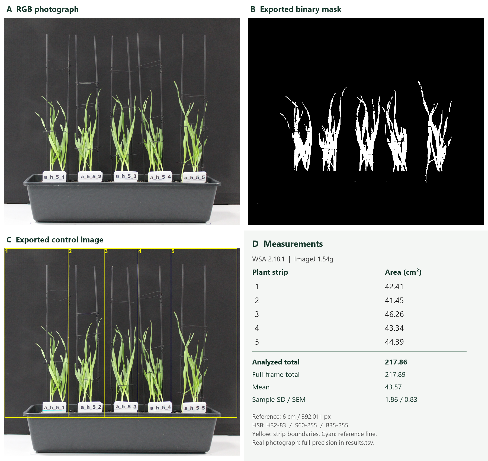

# WSA: Wheat Shoot Area

An **ImageJ macro for measuring projected leaf area** from RGB
photographs. WSA segments plant-colored pixels, measures their area in manually
positioned plant strips, and converts pixel counts to cm² using a visible reference.



*RGB input, binary mask, plant-strip boundaries and measurements from the same image.*

## Features

- Adjustable Hue, Saturation and Brightness thresholds.
- Per-image calibration using a reference of known length.
- Configurable number of plant strips, ordered from left to right.
- Area per strip, analyzed total and full-frame total, in pixels and cm².
- Mean, sample standard deviation and standard error across strips.
- Full-frame binary TIFF masks and PNG quality-control images.
- CSV/TSV results, saved settings and coordinates for repeatable analysis.
- Separate output folders for each run; source photographs are not modified.

## Requirements

- [ImageJ 1.54f or newer](https://imagej.net/ij/download.html).
- Single-frame, 8-bit-per-channel RGB images: JPG/JPEG, PNG, TIF/TIFF or BMP.
- A visible label or ruler of known length, approximately in the plane of the plants.

No additional plugins, Python or trained model are required for normal use.

## Quick start

1. Download and extract the repository.
2. Put the photographs in one input folder and create a separate output folder outside it.
3. Open ImageJ, choose **Plugins > Macros > Run...**, and select **`WSA.ijm`**.
4. Set the reference length, number of plant strips and color thresholds.
5. Choose the input and output folders.
6. On each image, draw a straight line along the known reference length and click OK.
7. Place one point per plant: horizontally near the center of its leaf spread,
   vertically at the label/base-of-shoots level. Keep points approximately level.
8. Click OK, repeat for the remaining images, and inspect the exported masks and QC images.

Click order does not matter. Input subfolders are not traversed. See the
[user guide](docs/USER_GUIDE.md) for detailed instructions.

## Settings

| Parameter | Default |
| --- | --- |
| Reference length | 6 cm; enter your actual reference length |
| Plant strips | 5 |
| Outer margin | 2 reference lengths |
| Hue | 32-83 |
| Saturation | 60-255 |
| Brightness | 35-255 |
| Table format | TSV with a decimal point |
| QC images | Enabled |

All HSB values use **0-255**, including hue. A pixel must satisfy all three
inclusive ranges. Thresholds can be edited in the dialog or supplied through
`settings.example.properties`.

## Outputs

Each run creates a new `WSA_<timestamp>` folder:

```text
results.tsv             Measurements and per-image scale; CSV is also available
settings.properties     Settings and replay paths
status.txt              Run completion status
annotations/            Reference lines, plant points and strip boundaries
masks/                  Binary TIFF masks: foreground=255, background=0
qc/                     PNG images with boundaries and reference lines
```

- **`AnalyzedLeaf_cm2`** is the accepted area inside all plant strips combined.
- **`Pot1_cm2` to `PotN_cm2`** are the individual strips, from left to right.
- **`FrameLeaf_cm2`** includes all accepted pixels in the entire photograph.
- **`Scale_cm_per_px`** records the measured reference conversion.

Use the saved settings and annotations to replay the same images. See the
[technical reference](docs/REFERENCE.md) for exact geometry, table fields and batch use.

## Real-image example

The [source photograph](examples/real/input/example.JPG) contains five plant
groups. With the default HSB settings and a 6 cm reference, WSA measures
**217.86 cm²** of projected leaf area inside the five marked strips.

The [results table](examples/real/output/results.tsv),
[full-frame mask](examples/real/output/example_mask.png) and saved coordinates
are included. See the [example instructions](examples/real/README.md) to repeat
the calculation. The source, mask and measurements use the same 3935 × 3456 image;
only the README illustration is resized for display.

## Scope

WSA measures visible **projected leaf area**, not total 3D leaf surface.
Overlapping leaves obscure one another. Diseased, dry or discolored tissue may
be excluded. A leaf crossing a strip boundary is assigned by position rather
than traced to its plant of origin.

Lighting, camera processing, background color and reference placement affect
the result. Inspect masks on representative photographs before interpreting
areas. SD and SEM describe variation across strips, not segmentation uncertainty.

## Developer checks

The integration checks run the actual macro in ImageJ. They require Python 3.10+,
NumPy, Pillow 10.1+ and a Java 11+ JDK, with Java AWT available.

```text
python tests/check_macro.py --ij-jar /absolute/path/to/ij.jar
```

The ImageJ runtime is downloaded separately and is not bundled. See
[TESTING.md](TESTING.md) for the checks covered.
