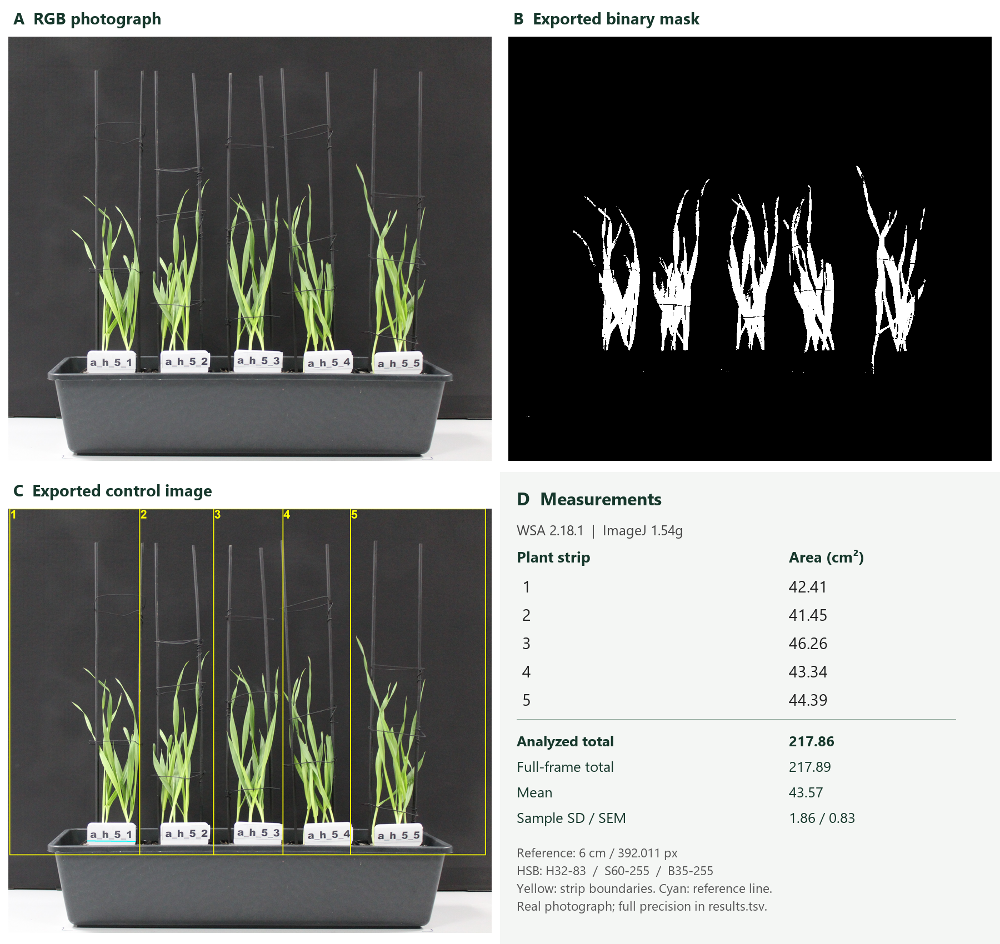

# Real-image example

This example comes from a completed manual run of WSA 2.18.1 in ImageJ 1.54g.
The input is `input/example.JPG` (3935 x 3456 pixels).
The reference is 6 cm, measured as 392.011479 pixels.
Thresholds are H32-83, S60-255 and B35-255 on ImageJ's 0-255 scale.

| Strip | Projected leaf area, cm² |
| --- | ---: |
| 1 | 42.409688 |
| 2 | 41.453892 |
| 3 | 46.256063 |
| 4 | 43.344166 |
| 5 | 44.392027 |
| Analyzed total | 217.855837 |
| Full-frame total | 217.887462 |

## Files and replay

`output/results.tsv`, `output/example.JPG_mask.tif` and `output/example.JPG_QC.png`
are the original exports. `output/example_mask.png` is a lossless PNG copy of the
same binary mask. `annotations/example.JPG.annotations.txt` preserves the actual
reference and plant points. The mask's full-frame and per-strip pixel counts were
checked against the table. `example.json` records settings and source checksums.

To repeat the calculation exactly, edit the three absolute paths in
`settings.example.properties`, keeping output outside input, then pass that file
to the macro as described in [the reference](../../docs/REFERENCE.md).
For interactive use, select the supplied input folder and a separate output folder.

The four-panel figure resizes the exports for display; it does not recompute or
retouch the segmentation. Manual reference and point placement affect the result.
These measurements describe the thresholded projected area, not ground-truth
total leaf surface or segmentation accuracy.
